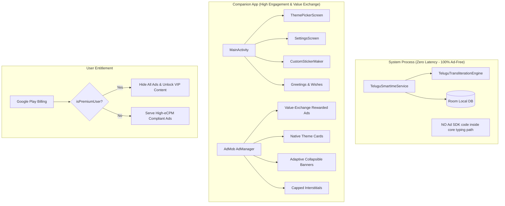
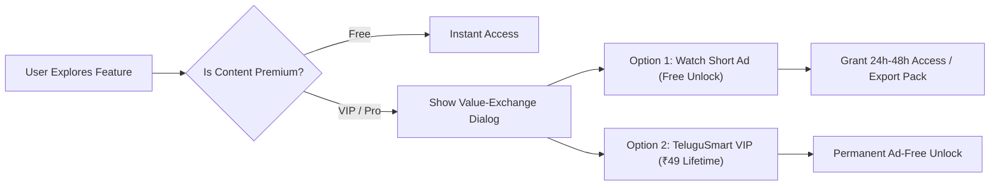
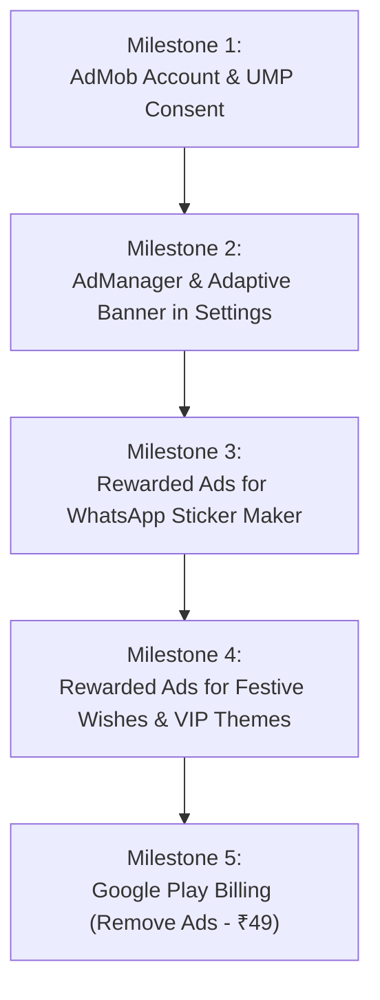

# TeluguSmart Keyboard: Ads Implementation & Monetization Strategy

This document provides a comprehensive technical, architectural, and policy analysis for integrating advertisements into the **TeluguSmart Keyboard** application, featuring high-converting, policy-compliant use cases tailored specifically to Telugu users.

---

## 1. Executive Summary & Core Principles

Monetizing an Android Input Method Editor (IME) requires a fundamentally different strategy compared to typical utility apps. Keyboards are mission-critical system components with extreme sensitivity to:
1. **Typing Latency**: Keystroke processing must remain under 16ms (60 FPS) to guarantee zero lag.
2. **User Privacy**: Soft keyboards handle passwords, OTPs, and private messages. Advertising SDKs must be completely decoupled from keystroke processing.
3. **Google Play Policy**: Google strictly forbids disruptive or unexpected ad formats that appear during typing or soft keyboard launch.



---

## 2. Google Play Developer Policy Compliance (Critical)

> [!CAUTION]
> **Zero Policy Violations Guarantee**: Violating Google Play's "Disruptive Ads" or "IME Keyboard" policies will result in immediate app suspension. The rules below must be followed strictly.

### A. The "Disruptive Ads" Policy
- **Strictly Prohibited**: Overlaying interstitial ads, pop-ups, or video ads while the keyboard is visible on screen.
- **Strictly Prohibited**: Triggering an interstitial ad when the user dismisses the keyboard back to their messaging app.
- **Strictly Prohibited**: Showing ads in the candidate/transliteration suggestion strip during typing.
- **Allowed & Encouraged**: User-initiated Rewarded Ads where the user explicitly requests to watch an ad in exchange for a feature, and Native Ads embedded in companion catalog feeds.

### B. Privacy & Keystroke Isolation
- Google Play strictly forbids transmitting user keystrokes, personal dictionaries, or clipboard data to advertising networks.
- The AdMob SDK must only reside in the companion application lifecycle or in isolated extension sheets (GIFs/Stickers).
- `FLAG_NO_PERSONALIZED_LEARNING` and password field protections must remain completely isolated from any network analytics.

---

## 3. High-Converting Use Cases & Placement Blueprint

Rather than intrusive banner ads that degrade user ratings, modern top-tier keyboards (e.g. SwiftKey, Facemoji, Bobble) monetize through **Value-Exchange Rewarded Ads** and **Native In-Feed Cards**. Users willingly watch ads because they receive high-value creative assets in return.



---

### Use Case 1: WhatsApp Telugu Sticker Export (`CustomStickerMakerSheet`)
- **User Context**: Users love creating custom Telugu meme stickers (Brahmanandam, Ali, funny movie dialogues, family photos with Telugu captions).
- **Placement**: Inside `CustomStickerMakerSheet`, after designing a sticker pack.
- **Trigger**: User taps **"Add Sticker Pack to WhatsApp"** or **"Export High-Res Sticker"**.
- **Ad Format**: **Rewarded Video Ad (15–30 sec)**.
- **Value Exchange**:
  - *"Watch a short video to export your custom 10-sticker pack directly to WhatsApp!"*
  - Alternatively: Unlock exclusive Telugu movie meme sticker templates.
- **eCPM & Revenue Impact**:
  - Rewarded video in India commands **$15.00 – $35.00 eCPM** (compared to $0.20 for banners).
  - WhatsApp sticker export is inherently viral; users share stickers in group chats, driving organic app installs.

---

### Use Case 2: Telugu Festival & Greeting Packs (`GreetingsWishesSheet`)
- **User Context**: Millions of Telugu users send festival greetings on WhatsApp/Facebook for **Sankranti, Ugadi, Diwali, Dasara, Vinayaka Chavithi, New Year**, and daily **శుభోదయం (Good Morning)**.
- **Placement**: Top category tabs in `GreetingsWishesSheet`.
- **Trigger**: Tapping on VIP festival categories or "Copy All Festival Wishes".
- **Ad Format**: **Rewarded Video Ad** or **Native Sponsored Wish Card**.
- **Value Exchange**:
  - Free tier: 5 standard wishes.
  - VIP Festival Pack: 30+ poetic, beautifully styled Telugu festival messages + calligraphy art cards.
  - User prompt: *"🔓 Watch 1 video to unlock the Complete 2026 Festive Wishes Pack for 48 hours!"*
- **eCPM & Revenue Impact**:
  - Enormous seasonal spikes during Sankranti and Ugadi, where ad engagement increases by 400%+.

---

### Use Case 3: Pro Custom Photo Keyboard Themes (`ThemePickerScreen`)
- **User Context**: Users love setting photos of their family, god/deity, or favorite cinema actors as the keyboard background.
- **Placement**: Custom Theme Creation Sheet in `ThemePickerScreen`.
- **Trigger**: Selecting advanced styling tools:
  - **Dynamic Blur / Glassmorphism Slider**
  - **Neon Glow Key Borders (Cyber Cyan & Neon Green)**
  - **Custom Key Font Color & Background Opacity**
- **Ad Format**: **Rewarded Video Ad** or **Frequency-Capped Interstitial on Save**.
- **Value Exchange**:
  - Standard photo background is free.
  - Advanced aesthetic customizations (glow borders, glassmorphism) unlock upon watching 1 video, or via lifetime VIP.
  - On tapping **"Save & Apply Pro Theme"**, user is prompted: *"Apply Pro Theme for Free (Watch Ad)"*.

---

### Use Case 4: Native Sponsored Theme Cards inside Theme Grid
- **User Context**: Users browse the Theme Store (`ThemePickerScreen`) to pick a new look.
- **Placement**: Slot #4 and Slot #8 in the 2-column theme browsing grid.
- **Ad Format**: **Native Advanced Ad (Compose View)**.
- **Design Integration**:
  - Rendered identically to a regular theme preview card (same rounded corners, subtle elevation, and typography).
  - Displays a miniature keyboard mockup skin with a discreet `Sponsored` / `Ad` tag.
  - Tapping opens the sponsor's destination without disrupting the user's settings.
- **eCPM & Revenue Impact**:
  - Native ads achieve **3x–5x higher Click-Through Rates (CTR)** than bottom banners without annoying users.

---

### Use Case 5: Exclusive Keyboard Sound & Haptic Packs (`SoundFeedbackHelper`)
- **User Context**: Users love the satisfying sound of mechanical keyboards, typewriters, or playful bubble clicks.
- **Placement**: Under "Sound & Vibration Feedback" dialog in `SettingsScreen`.
- **Current Profiles**: Standard Click, Mechanical Switch, Classic Typewriter, Water Drop, Cyber Blip.
- **VIP Profiles**:
  - 🎹 *Studio Mechanical (Thock Cherry MX)*
  - 🔔 *Temple Brass Bell (సాంప్రదాయ గంట)*
  - ⚡ *Gaming RGB Tactile*
- **Ad Format**: **Rewarded Video Ad**.
- **Value Exchange**: *"Tap to preview sound -> Watch 1 ad to unlock Studio Mechanical Sound for 7 days"*.

---

### Use Case 6: Stylish Social Bio Fonts (`FancyFontSheet`)
- **User Context**: Users generate stylish text for Instagram bios, WhatsApp statuses, and Free Fire/PUBG gamer names.
- **Placement**: `FancyFontSheet` accessed from the keyboard toolbar.
- **Ad Format**: **Rewarded Video Ad** (to unlock all 20+ viral font styles) and **Collapsible Banner Ad** at the bottom of the sheet.

---

### Summary of Blueprint & Revenue Comparison

| Placement & Feature | Target Screen | Ad Format | Est. eCPM (IN / US-NRI) | User Friction |
| :--- | :--- | :--- | :--- | :--- |
| **WhatsApp Sticker Export** | `CustomStickerMakerSheet` | Rewarded Video | $18.00 / $45.00 | **Zero** (High desire) |
| **Festival Wishes Pack** | `GreetingsWishesSheet` | Rewarded Video | $15.00 / $35.00 | **Zero** (Holiday value) |
| **Custom Photo Pro Theme** | `ThemePickerScreen` | Rewarded Video | $14.00 / $32.00 | **Zero** (Creative reward) |
| **Sponsored Theme Card** | `ThemePickerScreen` Grid | Native Advanced | $4.50 / $18.00 | **Very Low** (Blends natively) |
| **VIP Sound Tone Packs** | `SettingsScreen` (Sound) | Rewarded Video | $12.00 / $28.00 | **Zero** (Acoustic upgrade) |
| **Theme Save Milestone** | `MainActivity` (Exit modal) | Interstitial (4h cap) | $7.00 / $22.00 | **Low** (Natural milestone) |
| **Bottom Utility Banner** | `SettingsScreen` | Adaptive Collapsible Banner | $0.40 / $2.50 | **Minimal** (Off typing path) |

---

## 4. Technical Architecture & Separation of Concerns

```
com.example.
├── ads/
│   ├── AdManager.kt              // Singleton controlling preloading, lifecycles, and cooldowns
│   ├── AdPlacements.kt           // Centralized Ad Unit IDs and reward reward item logic
│   └── UmpConsentManager.kt      // Google UMP GDPR/CCPA consent flow
├── billing/
│   ├── BillingManager.kt         // Google Play Billing client for "Remove Ads" IAP
│   └── PremiumStateManager.kt    // Room/Prefs listener observing isPremiumUser
├── ui/components/
│   ├── AdaptiveBannerAd.kt       // Jetpack Compose Banner wrapper with shimmers
│   └── NativeThemeAdCard.kt      // Native Advanced Ad styled as a Material 3 Theme card
```

### Safety Safeguards in Code
1. **Zero Keyboard Service Linking**: `TeluguSmartImeService` does **NOT** import `com.google.android.gms.ads.*`. All ads are hosted strictly in Compose sheets or `MainActivity`.
2. **Frequency Capping**: Interstitial ads are hard-capped at **once per 4 hours** per user session using persistent timestamps.
3. **Graceful Fallback**: If an ad fails to load or the device is offline, features immediately grant access or continue silently without blocking the user.

---

## 5. Hybrid Monetization: Rewarded Unlocks + Ad-Free In-App Purchase

To monetize both free-tier users and power users who dislike ads:
- **Free Users (97% of audience)**: Watch rewarded videos to unlock VIP themes, stickers, and festival greetings for 48 hours.
- **TeluguSmart VIP Purchase (3% of audience)**:
  - One-time micro-transaction: **₹49 (India) / $0.99 (Global)** via Google Play Billing.
  - Benefits:
    - Permanently removes all banner, native, and interstitial ads.
    - Permanently unlocks all current and future themes, sound tones, and sticker tools.
    - Synchronized with Google Account (`billingClient.queryPurchasesAsync`).

---

## 6. Implementation Roadmap



1. **Milestone 1: AdMob & Consent Setup**
   - Register App on Google AdMob console.
   - Configure UMP Consent for European/California regulations.
2. **Milestone 2: Baseline Banner & Native Ads**
   - Place `AdaptiveBannerAd` in `SettingsScreen`.
   - Add `NativeThemeAdCard` into `ThemePickerScreen` grid.
3. **Milestone 3: Viral Rewarded Ad: WhatsApp Sticker Export**
   - Hook rewarded video into `CustomStickerMakerSheet` before triggering the WhatsApp intent.
4. **Milestone 4: Festival & Theme Unlocks**
   - Add "Unlock with Ad" badge to seasonal greetings and photo background customization tools.
5. **Milestone 5: Google Play Billing**
   - Implement `remove_ads_lifetime` in-app product to disable all ads dynamically.

